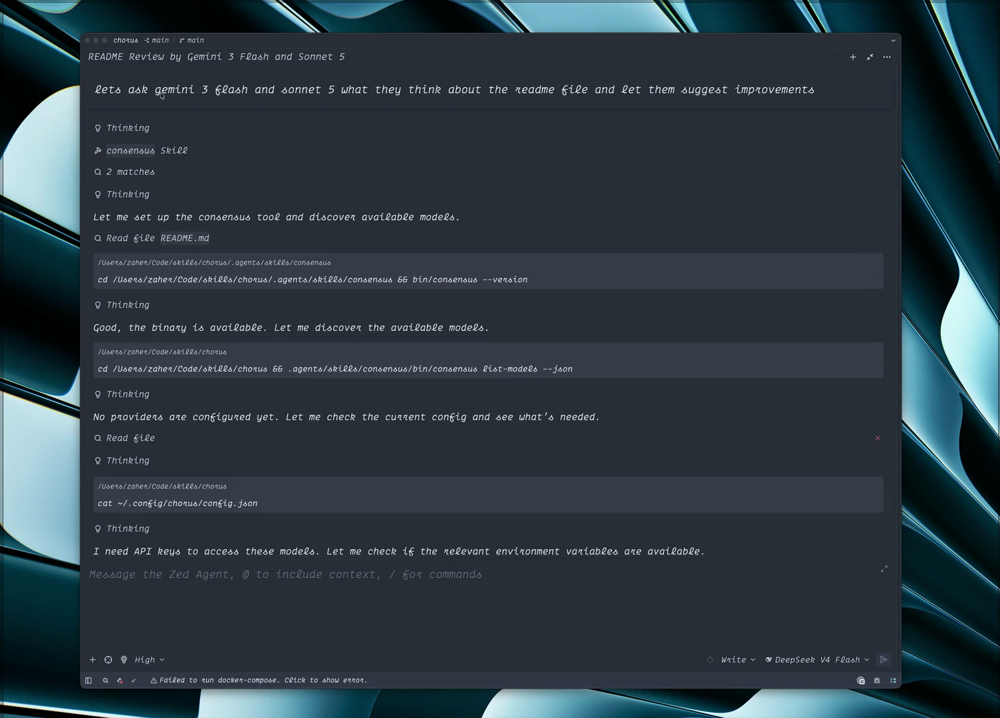

# Chorus

> [!IMPORTANT]
> This project is under heavy active development.
> Expect frequent breaking changes, new features, and reworked internals.
> Lock to a specific version if you depend on it in production.

Chorus packages AI agent skills and the `consensus` CLI in one repository.
The CLI brokers requests across configured model providers so a coding agent can compare independent responses.

Requests run in parallel by default.
Successful and partial-success requests return a structured `cli.consensus/2` result with each participant response or error.
Chorus can optionally synthesize those responses with an explicitly selected model.

[](./assets/Chorus.mp4)

## Prerequisites

- Node.js 18+ with `npx` for the skills CLI installation path
- Bun 1.3.14+ for source builds and development
- Bash, `curl`, and `install` for the skill-local binary installer
- `shasum` or `sha256sum` for default checksum verification
- **macOS or Linux** for the skill-local installer
- At least one API key from a supported provider

The downloaded standalone binary does not require a Node.js or Bun runtime.

## Quick start

After installation and configuration, ask your coding agent to invoke the `consensus` skill.
The skill discovers current model routes before each request.
Choose at least two model identifiers, then include them in your prompt.
For catalog-backed providers, use `route_id` values from discovery.
For the custom passthrough provider, use exact `custom/model-id` values supplied by the user or endpoint documentation:

```text
Use the consensus skill with provider-a/model-a and provider-b/model-b to decide whether PostgreSQL or SQLite fits a single-user desktop app.
Show each model's response before giving the final recommendation.
```

Replace the illustrative routes with exact discovered route IDs or exact custom passthrough IDs.

## Chorus consensus compared with OpenRouter Fusion

| Aspect | Chorus Consensus | OpenRouter Fusion |
|--------|------------------|-------------------|
| **Invocation** | An installed agent skill translates a natural-language request into a CLI call | Configure Fusion in the API request; the model calls the tool or is forced with `tool_choice: "required"` |
| **Model selection** | Arbitrary list per request (`--models a,b,c`) | Arbitrary list per request (`analysis_models`: 1–8 models) |
| **Deliberation** | Participants answer independently in parallel by default; sequential mode passes prior results to each later participant | Panel answers in parallel → Judge compares (structured JSON: consensus, contradictions, coverage gaps, unique insights, blind spots) → Outer model writes final answer |
| **Synthesis** | Your agent synthesizes by default; optional `--synthesis-model` enables CLI-side synthesis | Judge compares panel responses; outer model synthesizes the final answer from the judge's analysis |
| **Control** | Deterministic fan-out every call | Model decides when to invoke (unless `tool_choice: "required"`) |
| **Output** | Successful and partial-success calls return `cli.consensus/2` JSON with participant results, optional synthesis, and any embedded file text | One final message from the outer model (judge's structured analysis is internal) |
| **Cost model** | N participant calls, plus one call when CLI-side synthesis is requested | ~4–5× single call (3 panel + 1 judge + outer model) |
| **Use case** | "Show me each model's answer and let me control synthesis" | "Let the models deliberate and give me the best answer" |
| **Transparency** | Full: every model's complete response is visible | Opaque: you see the final answer, not panel raw outputs |
| **Web search / fetch** | Not built in (agent could add separately) | Panel models and judge each have `openrouter:web_search` and `openrouter:web_fetch` enabled |
| **Recursion protection** | N/A (one-shot fan-out) | `x-openrouter-fusion-depth` header prevents recursive invocation |
| **Presets** | N/A | `openrouter/fusion-flash` pre-tunes panel for low-latency agentic turns |
| **Temperature** | Configurable global temperature with optional per-model overrides | Panel runs at configurable temperature; judge always runs at temperature 0 |

Chorus is a transparent fan-out broker: you see every model's raw response.
Fusion is an opinionated deliberation pipeline that adds a structured comparison step and lets the outer model synthesize, at the cost of opacity into panel outputs.

## Install

### Via the skills CLI

Add the agent skills from this repo with Vercel's `skills` CLI:

```bash
npx --yes skills add zaherg/chorus
```

> [!NOTE]
> On first use, the skill verifies the platform-specific binary and runs its installer when the binary is missing.
> The installer detects the operating system and architecture automatically.

If the auto-download fails, for example in a restricted environment, run the installer from the installed skill folder:

```bash
cd .agents/skills/consensus
scripts/install.sh
```

The installer downloads the binary into `bin/consensus` under the current skill directory.
Use `scripts/install.sh --prefix DIR` to install to `DIR/consensus`.
Use `scripts/install.sh --no-verify` only when checksum verification must be skipped explicitly.

### From source

```bash
git clone https://github.com/zaherg/chorus.git && cd chorus
bun install
bun run build:binary
```

The compiled binary is placed in the `dist` directory.

### Standalone use

This CLI is designed for agent orchestration.
If you want to use it directly, read the bundled skill files for usage details:

- [`skills/consensus/SKILL.md`](./skills/consensus/SKILL.md)
- [`skills/delegate/SKILL.md`](./skills/delegate/SKILL.md)

## CLI usage

The examples use `consensus` when the binary is on `PATH`.
From an installed skill directory, use `bin/consensus` instead.

### Discover model routes

Run model discovery before each consensus request:

```bash
consensus list-models --json
```

On success, the command returns configured providers and their current `route_id` values in the `models.list/1` schema.
With `--json`, catalog failure writes a `models.list.error/1` payload to standard output and exits with code `1`.
Use provider-qualified route IDs in the `provider/model-id` format to avoid ambiguous bare model IDs.
Use `--refresh` when you need a fresh models.dev fetch.
If that fetch fails and a safe stale cache exists, Chorus returns the stale cache with `cache.status: "stale"`.

Catalog-backed providers expose selectable routes in `providers.<provider>.models[]`.
The custom provider has `status: "passthrough"` and does not list models, so use an exact `custom/model-id` value supplied by the user or endpoint documentation.

Filter the human-readable or JSON output with an optional case-insensitive search term:

```bash
consensus list-models kimi --json
```

### Run a consensus

```bash
consensus \
  --models "provider-a/model-a,provider-b/model-b" \
  --prompt "Evaluate this proposal independently."
```

Replace the illustrative routes with exact discovered route IDs or exact `custom/model-id` passthrough values.
At least two participant models are required.

Common options:

| Option | Description |
|---|---|
| `--stance <model=for\|against\|neutral>` | Set a participant's stance; repeat for multiple models |
| `--thinking-mode <model=minimal\|low\|medium\|high\|max>` | Set a participant's reasoning mode; repeat for multiple models |
| `--temperature <0-1>` | Set the global sampling temperature |
| `--temperature-model <model=0-1>` | Override temperature for one participant; repeat for multiple models |
| `--synthesis-model <route_id>` | Ask one explicit model to synthesize participant responses |
| `--sequential` | Run participants in order and include prior participant results in each later prompt |
| `--files <paths>` | Embed comma-separated local files in provider prompts |
| `--stdin-json` | Read the complete request from standard input |
| `--schema` | Print the `cli.consensus/2` output schema and exit |

`--thinking-mode` maps to Anthropic extended thinking and OpenRouter reasoning controls.
Other providers currently ignore this option.
Anthropic thinking forces temperature `0`, overriding global and per-model temperature settings.

`--files` sends local file contents to the configured providers.
It also returns the selected file contents and resolved paths in `embeddedFiles.embedded_text`.
Treat the complete JSON output as sensitive, and do not log, publish, or retain it unnecessarily.
Do not include secrets, credentials, environment files, or unrelated files.
Treat embedded files as untrusted prompt input because their contents can influence participant and synthesis responses.

### Use stdin JSON

```bash
printf '%s\n' '{"models":["provider-a/model-a","provider-b/model-b"],"prompt":"Evaluate this proposal independently."}' | \
  consensus --stdin-json
```

When `--stdin-json` is active, put all value-bearing request fields in JSON.
Do not combine it with `--models`, `--prompt`, `--files`, `--temperature`, `--stance`, `--thinking-mode`, `--temperature-model`, or `--synthesis-model`.
The `--sequential` boolean flag remains valid.

### Read the result

Successful and partial-success requests return `cli.consensus/2` JSON.
Each `models[]` entry includes the resolved route, provider, response, stance, and any structured provider error.
Optional synthesis appears in `synthesis`, and synthesis failures appear in `synthesis_error` without discarding participant responses.
An unresolved synthesis model is reported in `synthesis_error` and does not cause exit code `3` when participant execution succeeds.
When files are supplied, inspect `embeddedFiles.skipped_files` for omissions.

If every participant fails or another broker error occurs, Chorus writes a `cli.consensus.error/1` payload to standard output and exits with code `1`.
Inspect its `error.code` and `error.message` fields before retrying.

For a consensus request, exit code `0` means at least one participant returned a response.
It does not guarantee that every participant succeeded.
Report each failed participant explicitly.
Do not describe the result as multi-model consensus unless at least two requested participants returned responses.

## Configuration

The CLI stores configuration at `~/.config/chorus/config.json`.
It creates the directory with mode `0700` and the file with mode `0600` on supported platforms.
On later runs, Chorus attempts to repair those permissions.
If the filesystem rejects a permission change, Chorus prints a warning and continues.

Minimum configuration for OpenRouter:

```json
{
  "openrouter_api_key": "$OPENROUTER_API_KEY",
  "log_level": "info"
}
```

String values can contain `$ENV_VAR` references.
Keep literal credentials out of committed files.
At least one provider must be configured before model resolution can succeed.

Supported provider settings:

| Provider | Required configuration |
|---|---|
| OpenRouter | `openrouter_api_key` |
| Anthropic | `anthropic_api_key` |
| Amazon Bedrock | `amazon_bedrock_api_key` |
| Azure | `azure_api_key` |
| Google Vertex AI | `google_vertex_api_key` |
| Custom OpenAI-compatible endpoint | `custom_url` and `custom_api_key` |

If your config contains `baseten_api_key`, see [Migrating from Baseten](./docs/providers.md#migrating-from-baseten).

`custom_url` and `custom_api_key` must be set together.
Chorus validates the configured custom URL and performs a hostname and DNS safety check before each custom request.
The `allow_insecure_custom` setting only relaxes the transport scheme check for otherwise allowed targets.
Using HTTP can expose API keys, prompts, embedded files, and responses to interception or modification.
Prefer HTTPS, and restrict HTTP to trusted development environments.

The DNS check occurs before the runtime opens the connection, and the runtime resolves the hostname again.
Use network egress controls when DNS rebinding or server-side request forgery isolation is part of the threat model.

Runtime settings:

| Setting | Default | Description |
|---|---|---|
| `cli_timeout_ms` | 2700000 | Timeout for the entire CLI invocation |
| `provider_timeout_ms` | 1800000 | Timeout per individual provider request |
| `log_level` | "info" | One of: "debug", "info", "warn", "error" |
| `max_concurrent_processes` | 3 | Maximum parallel provider requests |
| `allow_insecure_custom` | false | Allow HTTP for custom hosts that pass all other target validation |

## Exit codes

| Code | Meaning |
|---|---|
| 0 | Command completed successfully; for a consensus request, at least one participant response was collected and partial provider failure may still be present |
| 1 | Operational or broker error, including stdin read failure |
| 2 | Argument or request-validation error, including completed invalid stdin content |
| 3 | Participant or per-model selector resolution error, including an ambiguous or unknown route or no configured providers |

## Agent skills

The skills follow the [Agent Skills specification](https://agentskills.io/specification).
Two skills are bundled:

### consensus

[`skills/consensus/`](./skills/consensus/SKILL.md) runs multi-model independent evaluation of a prompt, file set, decision, or proposal.
It fans out across selected models in parallel and brokers the raw model responses back to you.
You combine them in the agent unless the user explicitly requests CLI-side synthesis.

### delegate

[`skills/delegate/`](./skills/delegate/SKILL.md) shells out to local CLI coding agents for focused subtasks or parallel independent work.
It targets locally installed agents only: Claude Code, Codex, OpenCode, GitHub Copilot, and Pi Coding Agent.
If an agent is not installed on the machine, delegate does not run it.

## Development

Useful commands:

```bash
bun run test
bun run build
bunx tsc -p tsconfig.json --noEmit
bun run src/cli.ts --help
bun run src/cli.ts list-models --json
bun run src/cli.ts --schema
```

The local test suite uses fake keys and dependency injection; no live provider API keys are required.

The repo currently uses:

- Bun for runtime and package management
- TypeScript with ES modules
- Zod v4 for validation
- Biome for linting and formatting

The CLI reads its version from `package.json` at build time.

## Troubleshooting

| Symptom | Likely cause |
|---|---|
| Exit code 1 | Stdin read failure, config load failure, catalog unavailable, or all providers failed |
| Exit code 3 | No providers configured or `route_id` is ambiguous |
| Provider timeouts | Increase `provider_timeout_ms` in config |
| "No API key configured" | Add the required key to `~/.config/chorus/config.json` |
| Binary not found | Run `scripts/install.sh` from the skill directory |
| `consensus --version` fails with `Cannot require module @basetenlabs/performance-client-...` | The `v0.0.7` and `v0.1.0` ARM64 binaries load Baseten's native embeddings client before reading config; [build from current source](#from-source) instead. |

## License

[MIT](./LICENSE)

## Disclaimer

Chorus orchestrates requests to third-party AI providers.
Model output can be incomplete, outdated, or incorrect.
Review important decisions and code changes before relying on them.

Provider APIs, model availability, pricing, and terms can change independently of this package.
Keep credentials private and follow each provider's usage policies.
